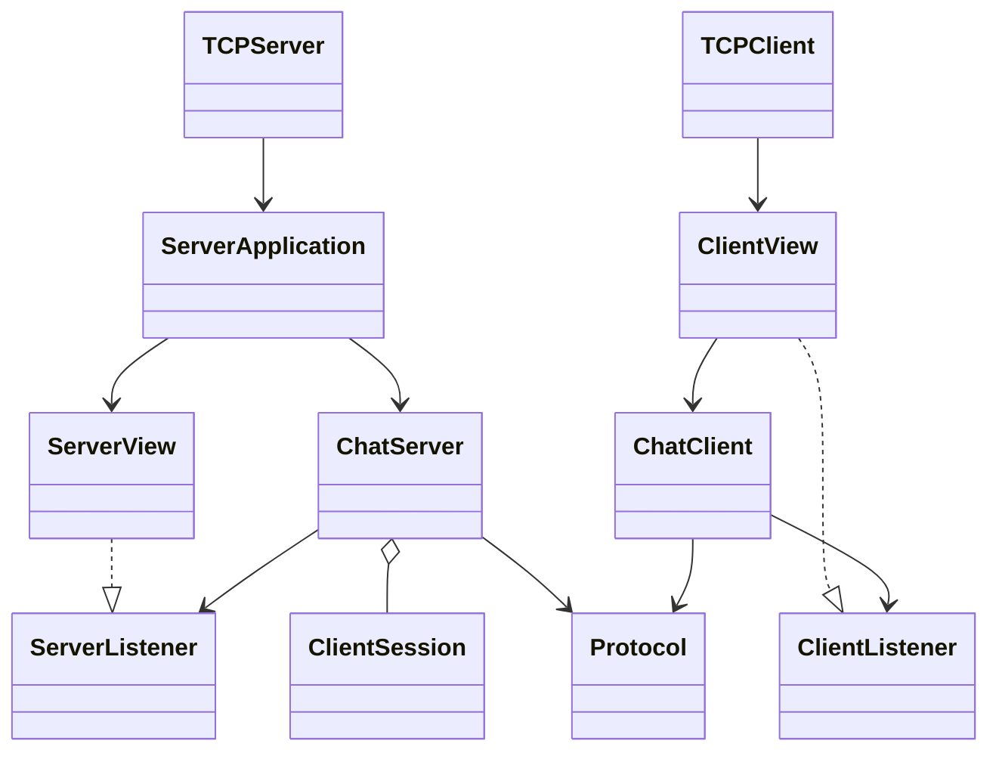
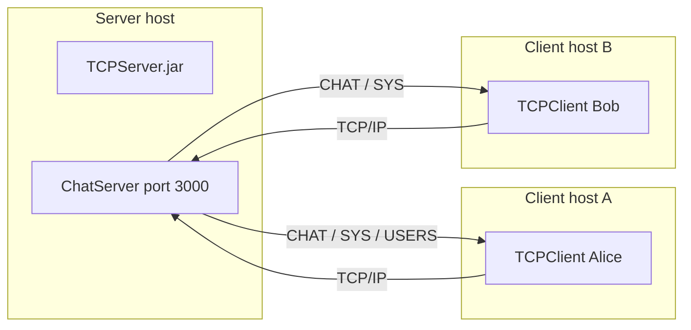

# Multi-client chat (TCPServer and TCPClient)

Group chat over TCP sockets. One JavaFX server accepts many clients. Each client is a JavaFX window. The server stamps every message with the sender’s name and the time, then delivers it to every open connection.

Author: `<Your Name>`

## Requirements

| Requirement | Where it lives |
| --- | --- |
| Maven projects for TCPServer and TCPClient | `tcp-server/`, `tcp-client/` |
| Executable jars | `artifacts/TCPServer`, `artifacts/TCPClient` |
| Username before chatting | Client login screen |
| Empty username → READ-ONLY MODE | `ChatServer.join`, `ChatClient.submit` |
| SEND button and Enter | `ClientView` composer |
| `allUsers` returns the active list to that user only | `ChatServer.onCommand` |
| Leave with `end`, `bye`, or LEAVE | `InputIntent`, LEAVE button |
| Online label and circle | Client header |
| Many clients at once, virtual threads | `ChatServer.acceptLoop`, `ClientSession` |
| Broadcast with username and time | `ChatServer.onMessage` |
| Live `ListView` of names, random background colors | `ServerView`, `ConnectedClient.colorHex` |
| Log lines `Server Started`, `Waiting for Client`, `Welcome [User]` | `ChatServer` |
| JavaFX `GridPane` and CSS | `ServerView`, `ClientView`, `shared/resources/css/chat.css` |
| Host and port loaded from `.properties` | `server.properties`, `client.properties` |
| Model independent of the view | `server.model`, `client.model` (no JavaFX imports) |
| `java TCPClient <host> <port>` and `java TCPServer` | `TCPClient`, `TCPServer` |

## Layout

```
tcp-server/     server window and socket acceptor
tcp-client/     client window and one connection
shared/java/    protocol and properties loader, compiled into both jars
artifacts/      runnable folders produced by mvn verify
docs/uml/       class, deployment, sequence, and use-case diagrams
docs/DEMO_SCRIPT.md
docs/technical-post.md
```

`ChatServer` and `ChatClient` do the I/O. The windows implement `ServerListener` and `ClientListener` and only then touch JavaFX controls. A test fails the build if a model source file mentions JavaFX.

## Build

JDK 26 is required (JavaFX 26.0.2). From the project root, with Maven on your PATH:

```
mvn verify
```

That runs the tests and writes:

```
artifacts/TCPServer/TCPServer.jar
artifacts/TCPServer/TCPServer.bat
artifacts/TCPServer/server.properties
artifacts/TCPServer/lib/

artifacts/TCPClient/TCPClient.jar
artifacts/TCPClient/TCPClient.bat
artifacts/TCPClient/client.properties
artifacts/TCPClient/lib/
```

## Run

Start the server first:

```
artifacts\TCPServer\TCPServer.bat
```

Then one window per person:

```
artifacts\TCPClient\TCPClient.bat localhost 3000
artifacts\TCPClient\TCPClient.bat localhost 3000
```

From IntelliJ or a terminal, the same entry points are:

```
mvn -pl tcp-server javafx:run
mvn -pl tcp-client javafx:run -Dclient.args="localhost 3000"
```

JavaFX is not inside the JDK. A bare `java TCPServer` cannot see the JavaFX modules. The batch files add the module path:

```
java --enable-native-access=javafx.graphics --module-path lib --add-modules javafx.controls -jar TCPServer.jar
java --enable-native-access=javafx.graphics --module-path lib --add-modules javafx.controls -jar TCPClient.jar localhost 3000
```

The main classes are still `TCPServer` and `TCPClient`, which is what the assignment asks for. If Windows asks whether to allow the server on the network, allow it when other machines will connect. For a local demo, `localhost` is enough.

## Configuration

`artifacts/TCPServer/server.properties`:

```
server.port=3000
server.bindAddress=0.0.0.0
```

`0.0.0.0` listens on every interface. Change the file and restart; do not recompile.

`artifacts/TCPClient/client.properties` supplies the host and port when you start the client with no arguments. Two arguments always win: `TCPClient.bat 192.168.1.20 3000`.

## How a session works

1. The client connects and sends `JOIN|Alice`, or `JOIN|` when the username box is empty.
2. The server replies `WELCOME|Alice|ACTIVE` or `WELCOME|Guest-1|READONLY`, logs `Welcome Alice`, and adds a colored row to the list.
3. A chat line becomes `CHAT|12:04:01|Alice|hello` and is sent to every connection, including the sender.
4. `allUsers` becomes `CMD|allUsers`. Only that client receives `USERS|Alice|Bob|Guest-1 (read-only)`.
5. `end`, `bye`, or LEAVE send `CMD|leave`. The server closes that socket and tells the others that the user left.

Read-only clients still receive chat, can run `allUsers`, and can leave. A normal message is refused with `READ-ONLY MODE`.

Usernames are 1–20 characters: letters, digits, spaces, `_`, and `-`. `allUsers`, `end`, `bye`, and names starting with `Guest-` are reserved.

## Diagrams

- `docs/uml/class-diagram.puml` and `class-diagram.png`
- `docs/uml/deployment-diagram.puml` and `deployment-diagram.png`
- `docs/uml/sequence-diagram.puml` and `sequence-diagram.png`
- `docs/uml/usecase-diagram.puml` and `usecase-diagram.png`

Open the `.puml` files in IntelliJ (PlantUML plugin) or any PlantUML renderer. The pictures below are the same models in Mermaid so they are visible on GitHub.





## Tests

`mvn verify` runs socket tests without opening a window: broadcast format, read-only refusal, `allUsers` delivered to one client, leave notifications, duplicate names, and the JavaFX boundary check.

## Demo video and write-up

`docs/DEMO_SCRIPT.md` is a timed 3-minute recording plan. Record that video yourself; this repository cannot include the recording.

`docs/technical-post.md` is a draft for Dev.to or Medium. Publish it under your name if you want the optional write-up.

## GitHub

Create an empty repository, then from this folder:

```
git init
git add .
git commit -m "Add multi-client TCP chat server and client."
git branch -M main
git remote add origin https://github.com/<you>/<repo>.git
git push -u origin main
```

Put the repository URL in the submission. Do not commit `target/`. The `.gitignore` already excludes it. `artifacts/` is the built app; regenerate it with `mvn verify` rather than treating it as source.

## Zip for submission

The course asks for `<StudentNames>_project1.zip`. After `mvn verify`, zip the project (source, `docs/`, `README.md`, and `artifacts/`) under that file name. Do not include `target/` or `.git` if the archive would be too large; the GitHub link carries the history.
